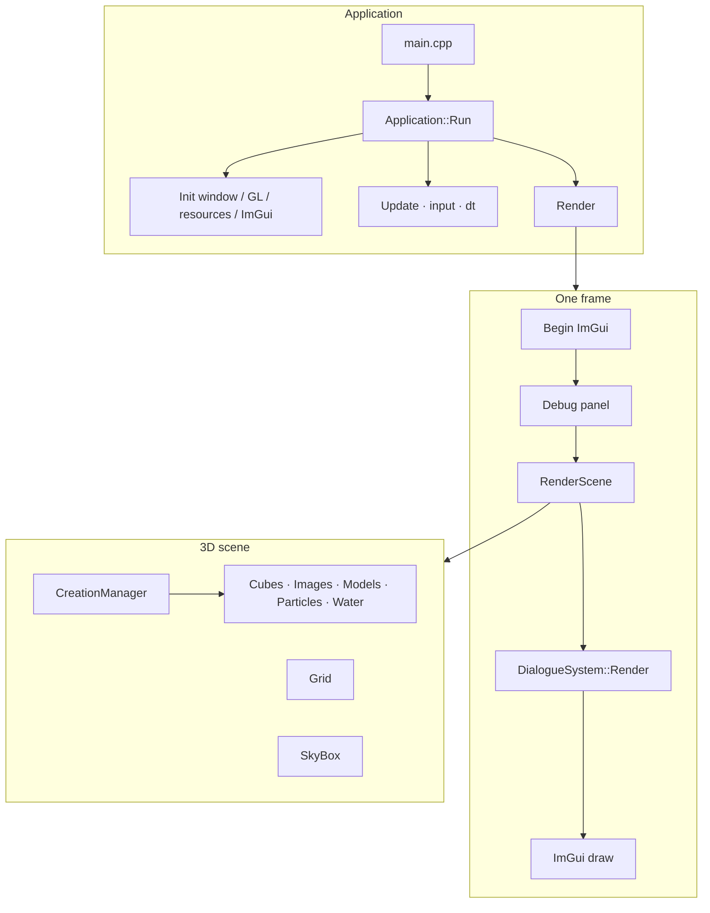
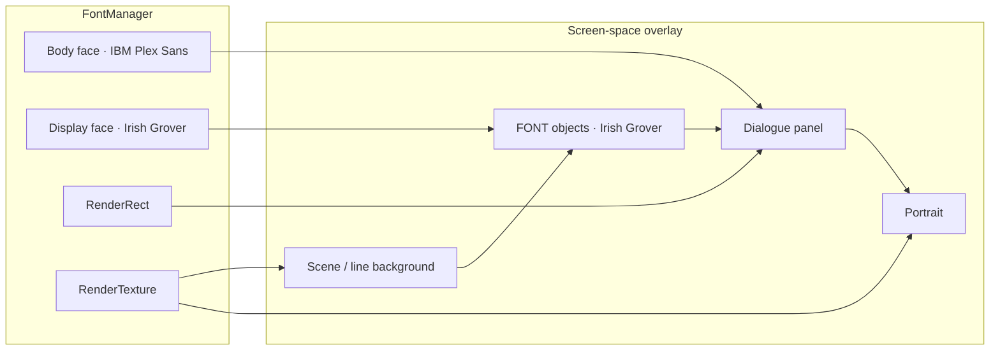
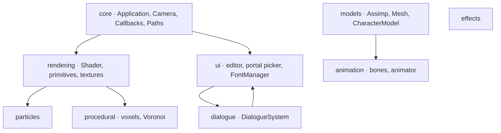
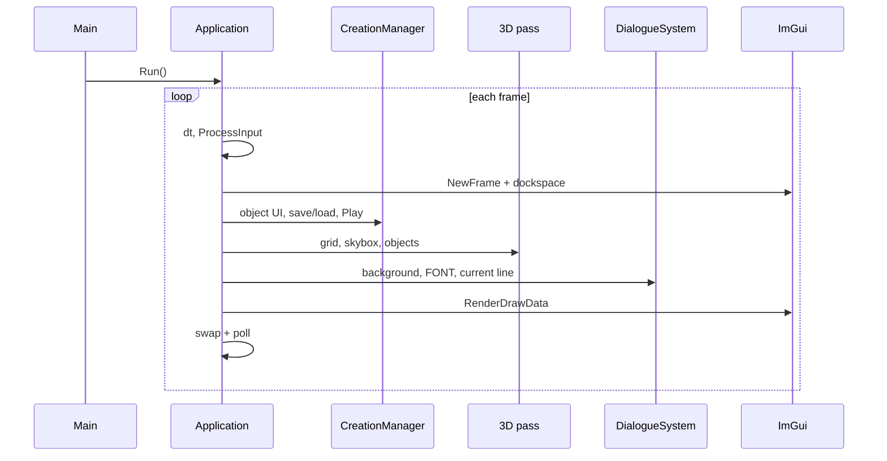
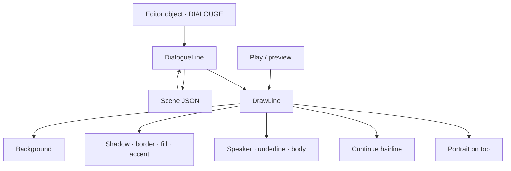
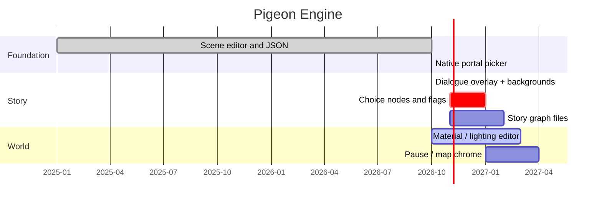

# Pigeon Engine

A Linux-native OpenGL engine with a live scene editor and a screen-space dialogue overlay.

> [!abstract] In one sentence
> Pigeon Engine is a C++23 / OpenGL 4.1 toolkit for composing 3D scenes in-editor, then laying visual-novel dialogue, portraits, and location art on top — without leaving the same executable.

- [[#Identity]]
- [[#Why it exists]]
- [[#Feature map]]
- [[#Architecture]]
- [[#Frame loop]]
- [[#Scene editor]]
- [[#Dialogue system]]
- [[#Rendering notes]]
- [[#Controls]]
- [[#Tech stack]]
- [[#Palette]]
- [[#Roadmap]]
- [[#Related notes]]
- [[#Source anchors]]

## Identity

| | |
|---|---|
| **Runtime** | Single process: 3D viewport + Dear ImGui editor + OpenGL overlay |
| **Editor** | Create, transform, preview, save, and load objects while the scene is running |
| **Story surface** | Dialogue is not ImGui. It is a bottom panel drawn in screen space |
| **Linux first** | GLFW window, FreeType fonts, XDG Desktop Portal file picker via sd-bus |
| **Tone** | Concrete / overcast / printed-matter. Not chrome, not anime UI |

> [!quote] Visual language
> Charcoal panel `#22272B`, hairline `#59636B`, body type `#EEECE6`, speaker `#C4A88A`. IBM Plex Sans for reading. Irish Grover only for novelty `FONT` objects. A 2px accent bar in the speaker colour is the one distinctive geometric mark.

Related notes: [[ENGINE_OVERVIEW]] · [[FOLDER_SYSTEM]] · [[DIALOGUE_STORY_SYSTEM]]

---

## Why it exists

Pigeon Engine sits between a toy renderer and a full engine. The loop is short on purpose:

1. Place meshes, images, particles, and water in a 3D scene.
2. Author dialogue lines as first-class objects.
3. Hit **Play Scene** and watch typewriter, hold, sequence, portrait bob, and location backgrounds.

The 3D world stays a real OpenGL scene. The conversation sits on top as overlay geometry — glyphs, rects, and textures — so the look of the story is independent of ImGui theming.

> [!tip] Design rule
> Game-facing UI stays in `FontManager` / `DialogueSystem`. ImGui is editor chrome only.

---

## Feature map

> [!success] Shipping now
> Scene editor · cubes, images, models, particles, water grids · skybox · debug HUD · JSON scene save/load · native Linux file picker · dialogue overlay · scene and per-line backgrounds · IBM Plex + Irish Grover · typewriter playback

> [!todo] Next
> Choice UI, flags, and a story graph — specified in [[DIALOGUE_STORY_SYSTEM]], not implemented on purpose yet.

### Viewport and editor

| Capability | What you get |
|---|---|
| Object creator | Particle, Cube, Model, Image, Water, Dialogue, Font |
| Transforms | World position / rotation / scale, or screen-space XY for overlay objects |
| Appearance | Colour, transparency, shininess, reflectivity, light intensity |
| Scene I/O | Named JSON under `Scenes/` — objects, dialogue fields, scene background |
| Preview | Select a dialogue object to preview that line; **Play Scene** walks the sequence |
| Debug dock | FPS, frame time, camera, object counts |

### Dialogue overlay

| Capability | What you get |
|---|---|
| Panel | Fill, hairline border, contact shadow, left accent bar |
| Type | IBM Plex Sans 48px atlas, wrap, letter-spacing on speaker names |
| Portrait | JPEG/PNG, left or right, overlap via negative gap, speaking bob |
| Background | Full-screen location art; scene default + per-line override with inherit |
| Playback | Typewriter, hold, ordered sequence, pulsing continue hairline |
| Authoring | Speaker, colours, padding, border, accent, gap, continue, paths |

### Rendering and content

| Capability | What you get |
|---|---|
| Models | Assimp: OBJ, glTF, GLB, FBX · Normal / Rainbow / Light modes · wireframe |
| Textures | stb_image through `loadTexture` · PNG, JPEG, BMP, TGA, GIF, HDR, … |
| Particles | Editor emitters plus a multi-effect system (basic, noise, colour cycle) |
| Environment | Grid, skybox cubemap, transparent windows, water grid LOD |
| Procedural | Voxel chunks, Voronoi experiments, extra GLSL programs in `assets/Shaders/` |
| Animation | Skeletal path exists (`animation`, `animator`, `bone`) for animated models |

---

## Architecture





> [!info] Coordinates
> Overlay space is **bottom-left pixels**. Dialogue `position` is the panel fill’s origin. Screen Position in the editor is the source of truth; layout clamps to ~48px margins and does not auto-centre.

### Module map



| Folder | Owns |
|---|---|
| `src/app/` | `main.cpp` — construct `Application`, call `Run()` |
| `src/core/` | Lifecycle, GLFW callbacks, VFS paths, camera input |
| `src/rendering/` | Primitives, texture load, geo helpers, GL diagnostics |
| `src/models/` | Editor model manager |
| `src/dialogue/` | Overlay composition, playback, JSON for lines |
| `src/ui/` | Object creator, dialogue fields, portal file chooser, fonts |
| `src/particles/` | GPU particle systems |
| `src/procedural/` | Voxel / Voronoi experiments |
| `src/effects/` | Standalone effects such as bird |
| `include/<system>/` | Public headers, mirrored by responsibility |
| `assets/` | Shaders, textures, fonts, models, cubemap |
| `external/` | GLAD, ImGui docking — do not put engine code here |

Placement rules live in [[FOLDER_SYSTEM]].

---

## Frame loop



Entry is deliberately tiny:

```cpp
#include "Application.h"

int main() {
  Application app;
  return app.Run();
}
```

`Application::Run()` owns init, the loop, and shutdown. GLFW callbacks and WASD routing live in `Callbacks`, not in `main`.

---

## Scene editor

The **Pigeon Engine - Object Creator & Editor** window is the production surface.

### Object types

| Type | Space | Notes |
|---|---|---|
| Particle | World | Count, speed, height, texture |
| Cube | World | Size, texture, colour, collision flag |
| 3D Model | World | Assimp path, render mode, wireframe, shader height |
| Image | World | Billboard / textured quad from a path |
| Water | World | Amplitude, speed, frequency, size, spacing, LOD |
| Dialogue | Screen | Full VN panel; participates in **Play Scene** |
| Font | Screen | Irish Grover overlay text; not sequenced |

### Scene management

- **Scene Name** — becomes `Scenes/<name>.json`
- **Save / Load** — full object graph plus dialogue JSON plus `backgroundPath`
- **Scene Background** — default full-screen art for that file
- **Play Scene / Stop** — walks `isDialogue` lines in `sequence` order
- **Speaking Order** — reorder speakers; per-step hold is the transition into the next line

> [!example] Typical authoring pass
> 1. Set scene background (kitchen, street, hallway).
> 2. Create Dialogue objects; set speaker, copy, portrait.
> 3. Leave later lines’ background empty so they inherit.
> 4. On a location change, set a new background path on that line.
> 5. Play Scene. Adjust hold, typewriter speed, and panel size while it runs.

### Native file picker

Browse uses **XDG Desktop Portal FileChooser** over the session bus (`libsystemd` sd-bus). No Qt, no GTK, no in-engine file explorer.

| Behaviour | Detail |
|---|---|
| Open | Native desktop chooser; thumbnails if the DE supports them |
| Filters | Images (PNG, JPEG, WEBP, BMP, TGA, GIF, HDR, …), models, JSON scenes |
| Async | Editor keeps rendering while the dialog is open |
| Cancel | Existing path is left untouched |
| Memory | Last directory is reused when practical |

Implementation: `PortalFileChooser` in `include/ui/` and `src/ui/`.

---

## Dialogue system

Dialogue is a `DialogueLine` plus a singleton `DialogueSystem`.



### Playback

| Step | Behaviour |
|---|---|
| Order | `sequence`, editable in Speaking Order |
| Reveal | `charsPerSecond` typewriter |
| Hold | `holdAfterLine` after the line is fully shown |
| Advance | Automatic to the next dialogue object |
| Preview | Selected line, fully revealed, no typewriter |
| FONT | Always drawn; never part of the play list |

### Background resolve

1. Current line `backgroundPath` if set.
2. Otherwise the last earlier line in sequence that set one.
3. Otherwise the **scene** `backgroundPath`.
4. Empty everywhere — the 3D viewport shows through.

> [!tip] Inherit on purpose
> Set art when the location changes. Leave the path empty on the following lines.

### Panel composition

Drawn in this order:

1. Full-screen background
2. Contact shadow
3. Hairline border + fill + speaker accent bar
4. Speaker (tracked small caps-style spacing) + 1px underline
5. Wrapped body
6. 12×2 continue tick, lower-right, pulsing, only after typewriter finishes
7. Portrait overlapping the panel edge; text column inset so copy does not run under the image

New objects use the printed-matter palette. Old JSON without the new layout keys keeps the legacy 6px border and 16px portrait gap.

### Typography

| Face | File | Used for |
|---|---|---|
| Body | `assets/fonts/IBM_Plex_Sans/IBMPlexSans-Regular.ttf` | Dialogue |
| Display | `assets/fonts/Irish_Grover/irish.ttf` | `FONT` overlay objects |

Both are 48px ASCII atlases (0–127). Continue ticks are rects, not Unicode arrows. Licenses ship next to the fonts (OFL / Apache).

Story-graph plans (ids, choices, flags) stay in [[DIALOGUE_STORY_SYSTEM]]. Sequential play in `DialogueSystem` is the current runtime.

---

## Rendering notes

### Models

Assimp triangulates on import. Expected data:

- UVs in channel 0
- Optional normals, tangents, bitangents, bone weights
- Textures embedded or beside the file

`Mesh::Draw()` uniform slots:

| Slot | Uniform |
|---|---|
| Diffuse | `texture_diffuseN` |
| Specular | `texture_specularN` |
| Normal | `texture_normalN` |
| Height | `texture_heightN` |

> [!warning] Black or flat mesh
> The shader is probably missing the slot the asset uses, or lighting uniforms are unset. Prefer glTF/GLB for new PBR-ready work; OBJ is fine for static props.

### Overlay shaders

| Program | Role |
|---|---|
| `font.vs` + `font.fs` | Glyphs and solid rects (`textAlpha`) |
| `font.vs` + `overlay.fs` | Portraits and backgrounds (RGBA, tint) |

No rounded-rect, glow, or gradient shaders. Sharp geometry is the look.

### Assets root

CMake defines `PIGEON_ASSET_DIR` as the project `assets/` folder. `PathManager` resolves textures, shaders, fonts, cubemap, and models through a small VFS so the binary can run from `build/` or the repo root.

---

## Controls

| Input | Action |
|---|---|
| <kbd>W</kbd> <kbd>A</kbd> <kbd>S</kbd> <kbd>D</kbd> | Move camera |
| Mouse | Look (when captured) |
| Scroll | Zoom |
| <kbd>Left Shift</kbd> | Faster move |
| <kbd>F</kbd> | Release cursor for the editor |
| <kbd>G</kbd> | Recapture cursor |
| <kbd>Esc</kbd> | Quit |

> [!info] Editor vs camera
> Press <kbd>F</kbd> before clicking ImGui. The debug panel also exposes cursor-release state.

---

## Tech stack

| Layer | Choice | Why |
|---|---|---|
| Language | C++23 | Project standard |
| Window / input | GLFW 3 | Context + callbacks |
| GL loader | GLAD | OpenGL 4.1 core |
| Math | GLM | Camera, transforms, colours |
| UI | Dear ImGui (docking) | Editor only |
| Models | Assimp | OBJ / glTF / FBX |
| Images | stb_image | No extra image lib |
| Fonts | FreeType | Two baked atlases |
| JSON | nlohmann/json | Scene + dialogue |
| Picker | XDG portal + sd-bus | Native Linux dialogs |
| Build | CMake 3.10+ | `compile_commands.json` on |

### Build

```sh
cmake -S . -B build
cmake --build build -j
./build/PigeonEngine
```

Linux packages you actually need: a C++23 compiler, OpenGL, GLFW (or the vendored tree), Assimp, FreeType, pkg-config, **libsystemd** (portal FileChooser). nlohmann/json is fetched if the system package is missing.

After adding files under `src/`, re-run CMake so the recursive glob picks them up.

---

## Palette

Use these on later chrome (pause, map, menus) so the game stays one object.

| Token | Hex | Role |
|---|---|---|
| Panel fill | `#22272B` | Dialogue box, ~0.90 alpha |
| Hairline | `#59636B` | 1.5px border |
| Body | `#EEECE6` | Readable copy |
| Speaker | `#C4A88A` | Name, accent bar, underline |
| Secondary | `#A5ADB2` | Continue tick, muted UI |

---

## Roadmap



| Status | Item |
|---|---|
| Done | Basic scene editor, Assimp + stb_image, JSON scenes, portal picker, VN overlay |
| In progress | Real-time material and lighting editor |
| Specified, not built | Choices, flags, story node ids — [[DIALOGUE_STORY_SYSTEM]] |
| Later | Pause/save UI, city map, per-district theming; reuse accent + hairline + Plex |

---

## Related notes

- [[ENGINE_OVERVIEW]] — runtime flow, model texture slots, asset guidelines
- [[FOLDER_SYSTEM]] — where new source, headers, and assets go
- [[DIALOGUE_STORY_SYSTEM]] — future graph: `StoryScene`, choices, flags, save format

---

## Source anchors

| System | Header | Source |
|---|---|---|
| Lifecycle | `include/core/Application.h` | `src/core/Application.cpp` |
| Input | `include/core/Callbacks.h` | `src/core/Callbacks.cpp` |
| Editor | `include/ui/IMGUIManager.h` | `src/ui/ObjectGenerationIMGUI.cpp` |
| Dialogue | `include/dialogue/DialogueSystem.h` | `src/dialogue/DialogueSystem.cpp` |
| Fonts | `include/ui/fontManager.h` | `src/ui/fontManager.cpp` |
| Picker | `include/ui/PortalFileChooser.h` | `src/ui/PortalFileChooser.cpp` |
| Models | `include/models/Model.h` | Assimp path in the header + `src/models/` |

---

*Pigeon Engine · Linux · OpenGL 4.1 · C++23*
